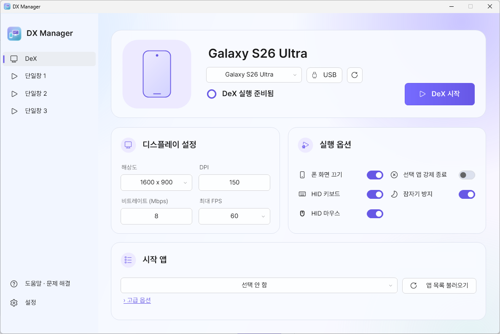
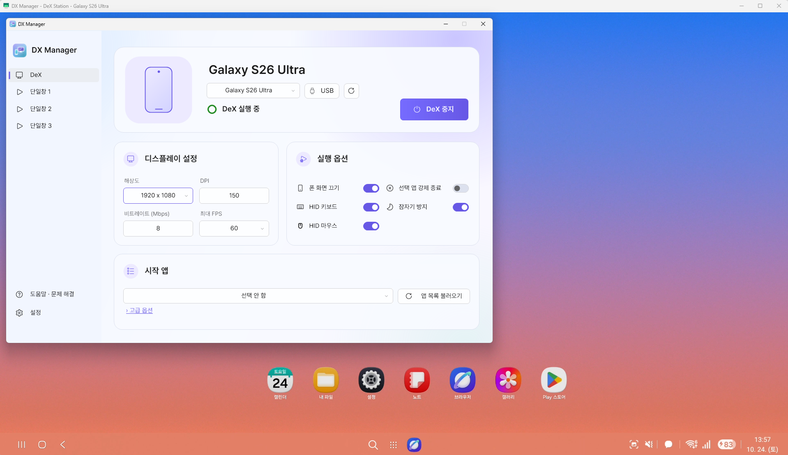
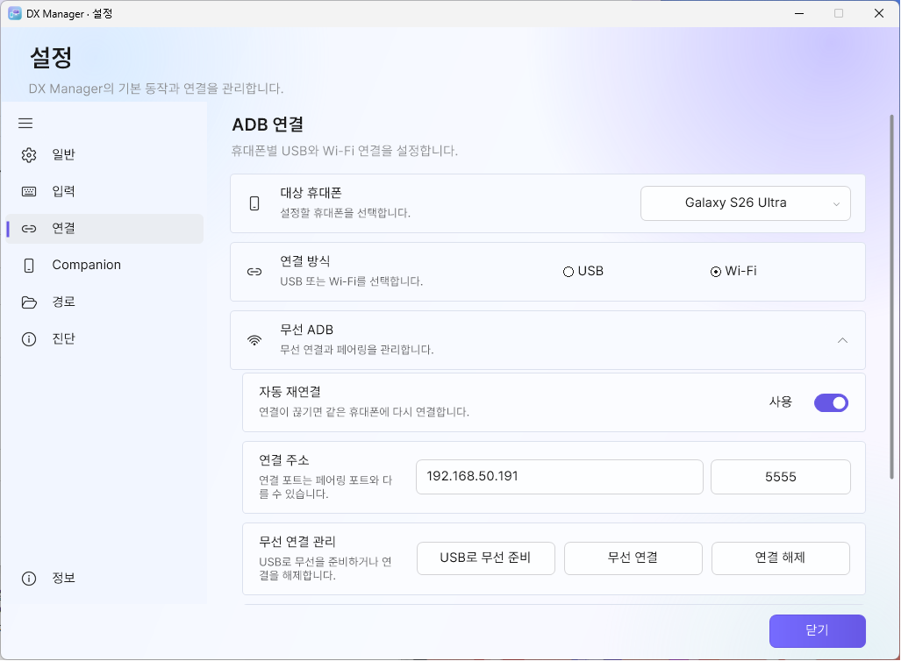
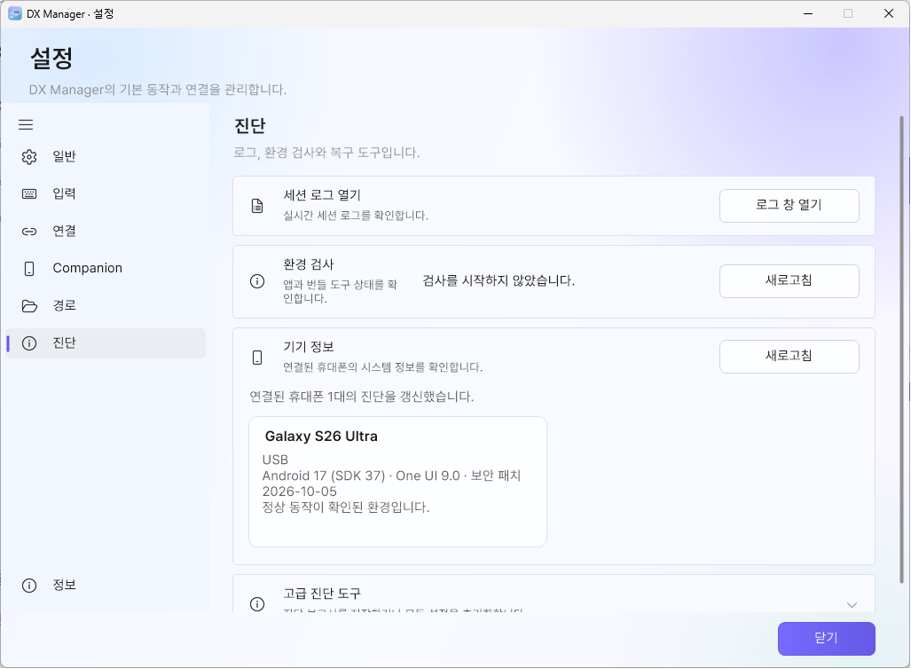
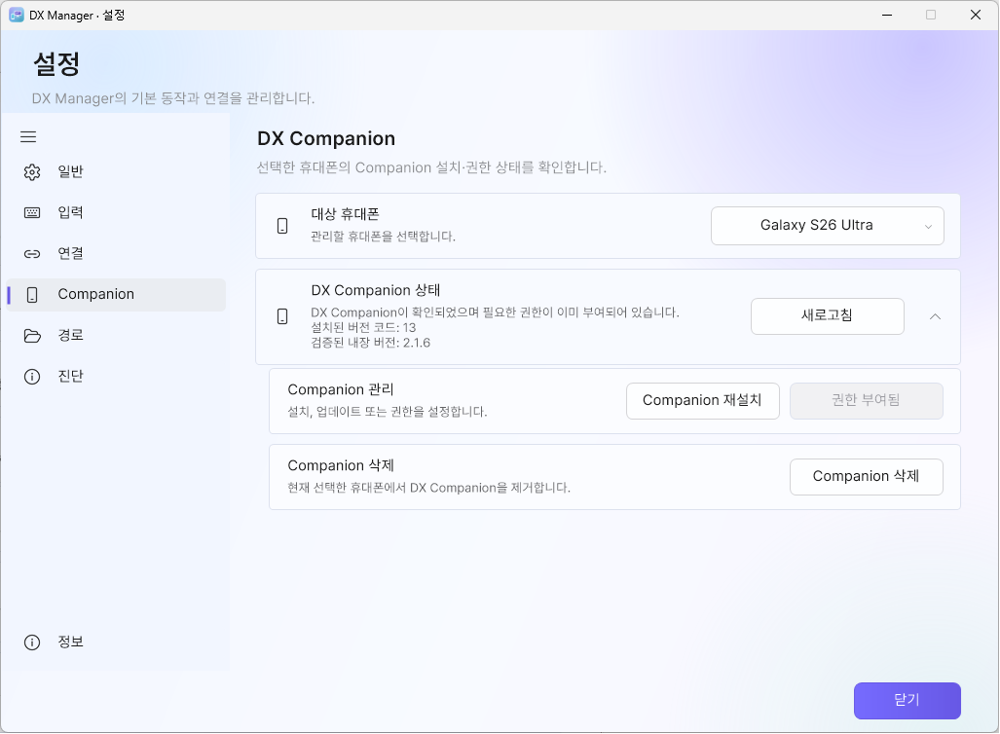
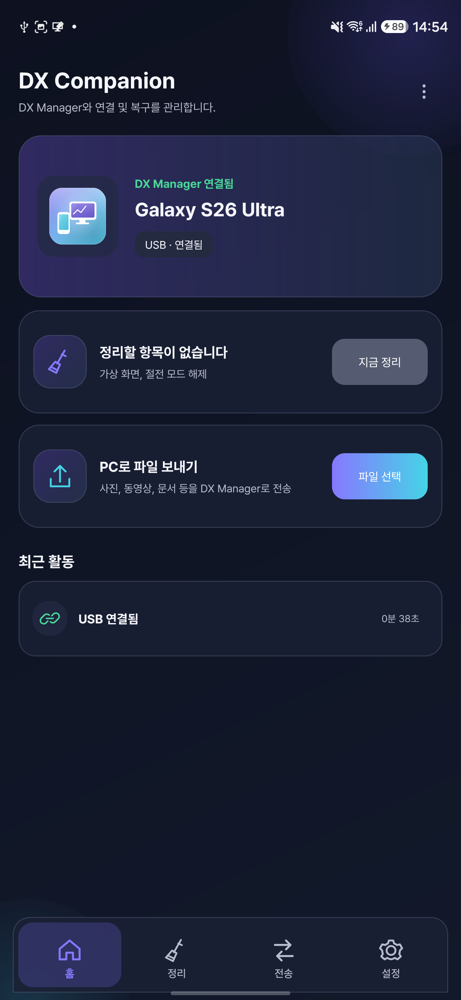
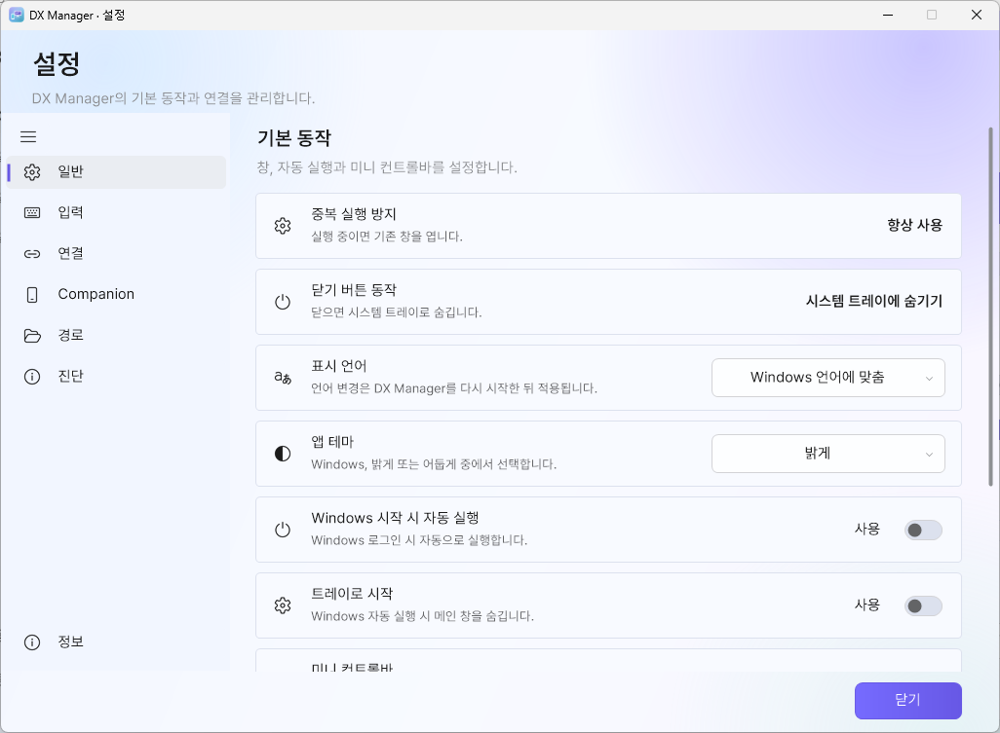
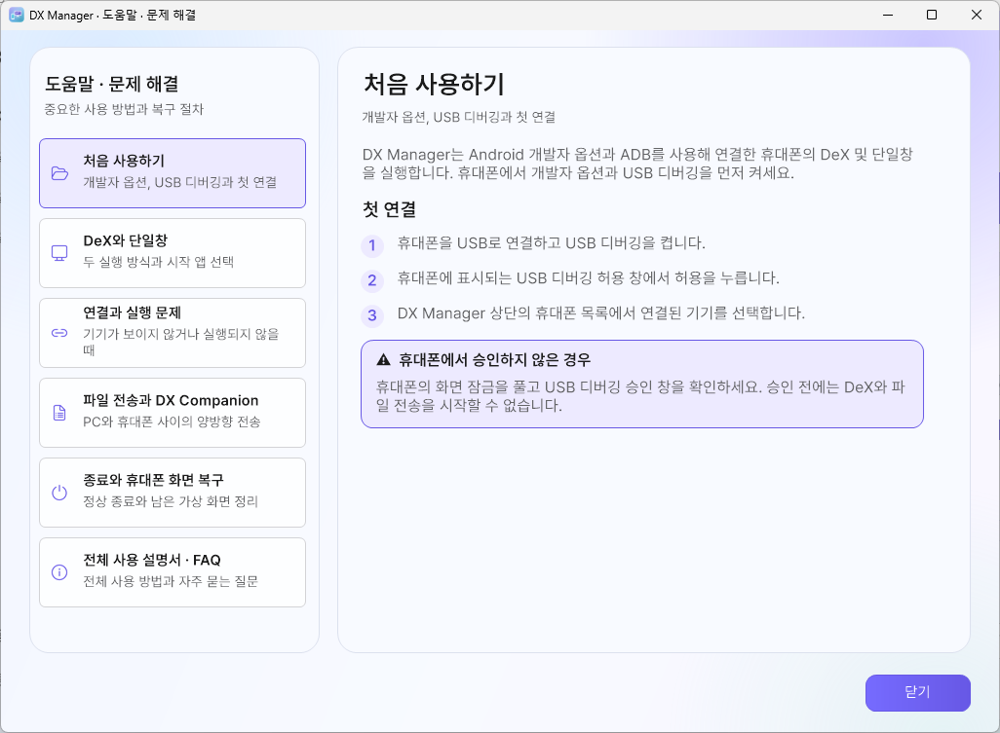

# DX Manager 2.5.0 한국어 사용 설명서

Windows용 2.5.0 기준, 2026-10-24 확인. [개요](../README.md) · [자주 묻는 질문](FAQ_KO.md) · [English](USER_GUIDE_EN.md)

## 1. 준비 사항

### PC

- 64비트 Windows 7 SP1, 8.1, 10 또는 11(32비트 Windows는 지원하지 않음)
- .NET Framework 4.6.2 이상
- Windows 7/8.1: 번들 레거시 ADB에 필요한 Universal CRT 업데이트
- 압축을 해제할 수 있는 충분한 저장 공간
- 실행 파일 옆에 설정·로그·스크린샷을 저장할 수 있는 쓰기 가능한 폴더

DX Manager는 Windows 7 SP1 및 오프라인·폐쇄망 PC를 지원하기 위한 최소
런타임으로 의도적으로 .NET Framework 4.6.2를 사용합니다. Windows 7 SP1에는
4.6.2가 기본 포함되지 않습니다. 설치되어 있지 않다면 [Microsoft 공식 .NET
Framework 4.6.2 페이지](https://dotnet.microsoft.com/en-us/download/dotnet-framework/net462)에서
런타임을 받으십시오. 인터넷이 연결되지 않은 PC는 다른 컴퓨터에서 오프라인
설치 파일을 받은 뒤 옮겨서 설치할 수 있습니다. 4.7.2 또는 4.8이 이미 설치된
경우에는 4.6.2로 낮추거나 따로 설치할 필요가 없으며, 더 최신인 .NET
Framework 4.x가 이 요구 사항을 충족합니다.

### 휴대폰

- Samsung DeX를 지원하는 Samsung Galaxy 기기
- 개발자 옵션 활성화
- USB 디버깅 활성화
- 데이터 통신이 가능한 USB 케이블

DeX 확인에는 Android 16 / One UI 8.x와 개발자가 보고한 Galaxy S26 Ultra / Android 17 / One UI 9 동작이 포함됩니다. One UI
7.x 이하에서는 원활한 동작을 확인하지 못했으며 DeX 창이 검게 표시될 수
있습니다. Samsung 펌웨어와 기기별 동작 차이는 여전히 있을 수 있습니다.

처음 연결할 때 휴대폰에 표시되는 RSA 디버깅 허용 창을 승인해야 합니다.
자주 사용하는 PC라면 **이 컴퓨터에서 항상 허용**을 선택할 수 있습니다.

  

<small>Android 시스템 화면 예시이며 기기·펌웨어에 따라 모양과 문구가 다를 수 있습니다.</small>

## 2. 설치와 첫 실행

[최신 릴리스](https://github.com/maze-mei/DX-Manager/releases/latest)에서 `DX-Manager-win-x64.zip`을 받습니다. ZIP 이름은 고정이며 내부 `DX Manager v2.5.0` 폴더가 버전을 나타냅니다.

1. 배포 ZIP의 압축을 현재 계정이 쓸 수 있는 폴더에 풉니다. 별도 쓰기
   권한을 설정하지 않았다면 `Program Files` 같은 보호 폴더는 피하십시오.
2. `DXManager.exe`를 실행합니다. 첫 안내를 읽고 확인란을 선택한 뒤 **확인하고 시작**을 누릅니다. 거절하면 종료하며 동의는 설정과 별도로 저장해 이후 실행에서 반복하지 않습니다.
3. Windows 보안 경고가 표시되면 파일의 출처를 확인한 뒤 실행 여부를
   결정합니다.
4. 휴대폰을 USB로 연결하고 RSA 디버깅을 승인합니다.
5. 상단 상태가 휴대폰 연결 상태로 바뀔 때까지 기다립니다.
6. **DeX 시작**을 누릅니다.

승인된 USB 또는 무선 기기를 감지하면 DX Manager는 설정된 기기 시작
대기시간이 지난 뒤 세션 시작 명령을 보냅니다. 기본값은 1초이며, 연결 직후
기기 상태가 안정된 다음 scrcpy를 시작하도록 돕습니다.

`DXManager.exe`만 다른 폴더로 복사하면 실행되지 않습니다. `tools` 폴더,
scrcpy DLL, `scrcpy-server`, 라이선스 파일을 포함한 배포 폴더 전체를
유지하십시오. 버전 2.5.0은 scrcpy 5.0.1을 포함합니다.

> [!IMPORTANT]
> 휴대폰을 연결한 상태에서 **DeX 중지**를 누르거나 `Left Alt+F8`을 누르거나,
> 시스템 트레이의 DX Manager 아이콘을 마우스 오른쪽 버튼으로 눌러 **종료**를
> 선택하십시오. 정리가 끝난 뒤 USB 또는 무선 연결을 끊으십시오.

남은 화면은 **개발자 옵션 > 보조 디스플레이 시뮬레이션**에서 아무 해상도나
한 번 선택하고, 같은 메뉴를 다시 열어 **없음**을 선택하면 제거됩니다.
처음부터 **없음**만 선택하면 남은 화면이 지워지지 않을 수 있습니다. 화면을
포함한 설명은 [FAQ Q1](FAQ_KO.md#q1-휴대폰에-작은-화면보조-디스플레이이-남아-있습니다)을
참조하십시오.

### 기존 설치에서 업데이트

1. 휴대폰 연결을 유지한 채 기존 프로그램의 트레이 **종료**를 선택하고 정리가 끝날 때까지 기다립니다.
2. 새 ZIP 전체를 풉니다. 내부 버전 폴더로 예전 프로그램과 구분하고 새 버전을 확인할 때까지 이전 폴더를 보관합니다.
3. 개인 설정을 유지하려면 두 프로그램이 꺼진 상태에서 예전 **config** 폴더를 새 폴더로 복사합니다.
   `settings.json`과, 존재한다면 `onboarding.json`·`update-notice.json`·`update-check.json`도 함께 옮깁니다.
   이 개인 파일들은 공개하거나 배포본에 넣지 마세요. 필요한 캡처·로그·수신 파일은 별도로 보관합니다.
4. 새 EXE를 실행해 **설정 > 정보**에서 버전을 확인합니다. 번들 Companion 버전이 올라갔으면 **설정 > Companion**에서 직접 업데이트합니다.

첫 안전 동의는 포터블 config에 저장되며 일반 설정 초기화와 별개입니다.
동의 기록이 없는 새 압축 해제 폴더는 새 설치로 취급합니다.
2.0.1까지의 기존 프로그램에는 업데이트 확인 기능이 없으므로 공식 릴리스에서 2.5.0을 직접 받으세요.
프로그램은 실행 파일을 자동으로 다운로드하거나 교체하지 않습니다.

<small>USB로 연결된 휴대폰과 DeX 실행 준비 상태를 보여줍니다.</small>

### 여러 휴대폰 사용

기기 선택기에서 대상 휴대폰을 선택한 뒤 설정을 바꾸거나 시작하세요. 휴대폰마다 DeX·단일창 세 슬롯의
설정, 앱 프로필, 연결 환경, Companion·전송 세션을 따로 유지합니다. 같은 물리 휴대폰의 USB와 무선 ADB는
하나의 기기 항목으로 합쳐집니다.

연결 배지는 USB·Wi-Fi·동시 연결 상태를 표시합니다. 새 수동·자동 실행은 승인된 USB가 있으면 우선 사용하고,
없으면 승인된 무선 연결을 사용합니다. 실행 중인 창은 시작할 때 사용한 연결을 유지합니다. USB를 뽑으면
그 연결을 사용하던 창을 중지하며, 남아 있는 Wi-Fi로 자동 재실행하거나 세션을 옮기지 않습니다. 이후 직접
시작하면 남은 연결을 사용할 수 있고, 실제 재연결 때는 저장된 자동 실행 설정을 따릅니다.

scrcpy 창 제목에는 대상 휴대폰 이름이 표시됩니다. 휴대폰→PC 파일은 설정된 PC 수신 폴더 아래
휴대폰 이름별 하위 폴더에 저장됩니다. 기기 탭을 바꿔도 다른 휴대폰의 실행 중인 창은 유지됩니다.

## 3. DeX 모드

왼쪽 메뉴에서 **DeX**를 선택합니다.

<small>개발자의 휴대폰으로 촬영한 DeX 실행 화면입니다. 단일창 세 슬롯도 함께 사용할 수 있습니다.</small>

### 화면 설정

- **해상도**: 프리셋 또는 사용자 지정 크기
- **DPI**: Android 화면 배율
- **비트레이트**: 영상 품질과 네트워크 사용량
- **최대 FPS**: 30, 60(기본값), **120 (실험적)**

120 FPS는 휴대폰 화면을 켜두어야 합니다. 120에서는 화면 끄기를 사용할 수
없으며, 30/60으로 돌아오면 이전 값(원래 화면 켜짐을 원했던 경우 포함)을
정확히 복원합니다. 기기·모드·앱 프로필별로 저장됩니다. 같은 휴대폰에서
120 FPS 창이 하나라도 실행 중이면 다른 창의 화면 끄기 요청은 보류합니다.

120을 선택할 때에는 팝업이 없고 **실제 120 FPS 실행 전마다 한 번** 경고를
확인합니다. 저장된 설정, 트레이·자동 실행, 설정 적용에 따른 재실행도 같습니다.
취소하면 실행하지 않습니다. 발열·배터리 소모와 OLED 영구 번인 위험이 있으므로
장시간 사용하거나 켜둔 채 방치하지 말고 과열 시 중단하세요. 실제 FPS는 기기·앱·
입력 상태에 따라 달라지며 120 FPS 고정 동작을 보장하지 않습니다.

고급 인자의 `--max-fps` 및 화면 끄기 인자로 이 규칙을 우회할 수 없습니다.
FPS 선택기에서 설정하세요.

DPI 값이 작을수록 화면의 UI 요소가 작아져 한 화면에 더 많은 정보를 표시할
수 있습니다.

사용자 지정 해상도는 프리셋과 별도로 저장됩니다. 다른 프리셋을 선택한 뒤
다시 사용자 지정을 선택해도 마지막 사용자 지정 값이 복원됩니다.

scrcpy 창은 PC 모니터와 창 크기에 맞춰 영상을 자동으로 축소하여 표시합니다.
따라서 PC에서 보이는 창의 크기와 관계없이 실제 DeX 내부 해상도는 DX
Manager에서 설정한 값으로 동작합니다. 사용자 지정 가로·세로 값은 각각
4096까지 입력할 수 있습니다.

### 하드웨어 디코딩

번들 scrcpy 5.0.1의 DeX·단일창 세 슬롯에는 --hwdec=auto를 자동으로 넣습니다. 실제 선택된 디코더는 로그에서 확인하며, OS·GPU·드라이버에 따라 달라집니다. CPU 사용량만으로 판단하지 마세요. 고급 인자에서 --hwdec를 직접 지정한 경우 그 값을 유지합니다.

### 실행 옵션

- **폰 화면 끄기 (`-S`)**: scrcpy 실행 중 실제 휴대폰 화면 끄기
- **HID 키보드 (`-K`)**: 키보드를 Android 입력 장치로 전달
- **HID 마우스 (`-M`)**: 마우스를 Android 입력 장치로 전달
- **선택 앱 강제 종료**: 앱을 시작하기 전에 기존 프로세스 종료
- **잠자기 방지 (`-w`)**: 실행 중 휴대폰 활성 상태 유지

폰 화면 끄기(`-S`)는 휴대폰을 잠그는 기능이 아니라 활성 상태에서 물리
디스플레이만 끄는 기능입니다. 화면이 꺼져 있어도 터치, 길게 누르기, 지문
인증 등의 입력은 동작할 수 있으므로 의도하지 않은 설정 변경이나 앱 조작에
주의하십시오.

HID 키보드와 HID 마우스를 끄면 scrcpy의 비 HID 입력 방식을 사용합니다.
이때 마우스 입력은 화면을 직접 터치하는 것처럼 전달되며, 마우스 버튼을
누르고 있으면 길게 누르기 동작으로 처리됩니다.

비 HID 키보드는 HID 방식과 일부 동작이 다릅니다. 영문 입력은 가능하지만
한영키가 동작하지 않을 수 있으므로 왼쪽 Shift+Space로 입력 언어를
전환하십시오. Android 키보드와 시스템 설정에 따라 이 조합도 동작하지 않을
수 있습니다.

설정은 선택한 휴대폰·모드에 저장됩니다. 실행 중에는 **변경 적용**으로 해당 세션을 재시작하거나 중지 후 다시 시작하세요. 120 FPS 재실행은 경고를 다시 확인합니다.

## 4. 단일창 모드

왼쪽 메뉴에서 **단일창 1**, **단일창 2**, **단일창 3** 중 하나를
선택합니다. 각 슬롯은 해상도, DPI, 비트레이트, FPS, 앱과 실행 옵션을
독립적으로 기억합니다.

1. **앱 목록 불러오기**를 누릅니다.
2. 시작할 앱을 선택합니다.
3. 화면과 실행 옵션을 설정합니다.
4. **단일창 시작**을 누릅니다.

**단일창은 각 슬롯에 시작 앱을 지정해야 실행할 수 있습니다.** **선택 안 함** 상태에서는 시작하지 않으며, 안내는 해당 휴대폰·슬롯에만 표시됩니다. DeX 모드는 시작 앱이 선택 사항이므로 **선택 안 함**으로 실행할 수 있습니다.

앱 목록은 휴대폰마다 따로 보관하며 현재 DX Manager 실행 중 기기를 바꾸면
그 휴대폰에서 마지막으로 불러온 목록을 복원합니다. 완료하면 불러온 앱 개수를
잠깐 표시합니다. 기기 전환 뒤 늦게 도착한 결과는 원래 조회한 휴대폰에 저장합니다.

자동으로 정상 실행된 앱은 해당 휴대폰의 최근 앱 목록에 저장되어 같은 휴대폰의
다른 슬롯이나 다음 실행에서 선택할 수 있습니다. 예전 공통 최근 앱 데이터는
설정에 보존하되 특정 휴대폰에 자동 배정하지 않으며 저장된 시작 앱 선택은 유지합니다.

### 앱 프로필

단일창 모드는 선택한 Android 패키지마다 프로필 하나를 저장할 수 있습니다.
원하는 화면과 실행 옵션을 만든 뒤 **앱 프로필 > 현재 설정 저장**을 선택하십시오.
해상도, DPI, 비트레이트, FPS, 화면 끄기, 잠자기 방지, HID 입력, 강제 종료,
동적 창 크기와 추가 인자가 저장됩니다. 세 단일창 중 어느 슬롯에서든 같은 앱을
선택하면 저장된 프로필이 해당 슬롯에 자동으로 적용됩니다.

같은 메뉴에서 현재 설정으로 덮어쓰거나 프로필을 삭제할 수 있습니다. 프로필을
삭제해도 현재 슬롯에 이미 불러온 설정은 바뀌지 않으며, 단일창 프로필은 DeX
모드 설정에 영향을 주지 않습니다.

단일창은 DeX 가상화면을 재사용하지 않습니다. scrcpy의 새 가상 디스플레이
기능으로 각각 별도의 화면을 만들며, DeX와 단일창 3개를 동시에 실행할 수
있습니다.

- **동적 창 크기 (`-x`)**: 창 크기에 맞춰 가상 디스플레이 크기 조정
- 단일창 제목: `DX Manager - 앱 이름`
- DeX 창 제목: `DX Manager - DeX Station`

게임에 따라 HID 키보드와 HID 마우스를 끄고 단일창 모드를 사용하는 편이
입력 호환성이 더 좋을 수 있습니다.

## 5. 드래그 앤 드롭 파일 전송

실행 중인 DeX 또는 단일창의 scrcpy 창에 파일을 하나 이상 놓거나 폴더 전체를
놓을 수 있습니다. DX Manager 파일 전송은 기본값으로 켜져 있으며, Windows
7 SP1부터 11까지 호환되는 경로로 한글·일본어 등 Unicode 이름을 보존합니다. 휴대폰의 기본
저장 위치는 `/sdcard/Download/`이며 **설정 > 경로**에서 바꿀 수 있습니다. 변경한 위치는 새로 여는 DeX와 단일창부터
적용됩니다. 안전을 위해 저장 위치는 `/sdcard/` 또는 `/storage/emulated/0/`
아래 폴더만 지정할 수 있습니다. **캡처의 휴대폰 저장 폴더**와 **드롭 파일
휴대폰 저장 폴더** 옆의 **찾아보기**를 누르면 연결된 휴대폰의 기존 폴더를
선택할 수 있습니다. Android 경로는 Windows 경로와 달리 `/` 구분자를
사용합니다.

폴더를 놓으면 최상위 폴더, 하위 폴더, 파일과 빈 폴더를 그대로 보존합니다.
선택한 폴더 밖으로 따라가지 않도록 정션, 심볼릭 링크 등 재분석 지점은
건너뜁니다. APK 파일을 단독으로 놓으면 scrcpy의 설치 동작을 유지하고, 폴더
안에 포함된 APK는 일반 파일로 복사합니다.

독립적으로 이동할 수 있는 작은 상태창은 처음에 scrcpy 창 옆에 열립니다.
현재 전송 항목과 다음 대기 항목 4개, 파일 크기, 경과 시간 및
완료·실패·대기 수를 표시합니다. 지원하는 모든 Windows와 ADB 조합에서 정확한
전송 바이트를 얻을 수 없으므로 진행률과 남은 시간은 표시하지 않습니다.
**취소**를 누르면 해당 scrcpy 창의 진행 중·대기 중 전송을 모두 중단하고
휴대폰의 임시 데이터를 정리하도록 시도합니다. 이미 끝난 이동 결과가 엇갈리지
않도록 짧은 최종 저장 단계에서는 취소 버튼이 비활성화됩니다.

휴대폰의 기존 파일과 폴더는 덮어쓰지 않습니다. 같은 이름이 있으면
`이름 (1).확장자`, `이름 (2).확장자` 또는 `폴더 (1)`로 저장합니다.

현재 **설정 > 경로**에는 관리형 전송 대상 경로가 표시되며 별도의 관리형 모드 스위치는 없습니다.
고급 설정으로 끄려면 완전히 종료한 뒤 `config/settings.json`을 백업하고
`Features.ManagedFileTransferEnabled`를 `false`로 바꾸세요. 프로그램과 scrcpy 창을 다시 열면 순정 파일 드롭을 사용합니다.
단독 APK 설치 드롭과 무관한 ADB 명령은 기존 동작을 유지합니다.

## 6. USB 연결

기본 연결 방식입니다.

1. 휴대폰에서 USB 디버깅을 켭니다.
   USB 디버깅 항목이 회색으로 표시되어 선택할 수 없다면 Galaxy의
   **설정 > 보안 및 개인정보 보호 > 보안 위험 자동 차단**을 확인하십시오.
   이 기능을 끄면 USB 디버깅을 활성화할 수 있습니다. 세부 설정의
   **자동으로 켜기**가 활성화되어 있으면 약 30분 후 자동 차단이 다시 켜져
   USB 디버깅 연결이 끊어질 수 있습니다. 메뉴 이름과 위치는 One UI 버전에
   따라 다를 수 있습니다.
2. USB 케이블로 PC와 휴대폰을 연결합니다.
3. RSA 디버깅 허용 창을 승인합니다.
4. DX Manager에서 연결 상태를 확인합니다.

장치가 나타나지 않으면 케이블, USB 포트, Samsung USB 드라이버와 RSA
승인 상태를 확인한 뒤 **설정 > 진단 > 환경 검사 > 새로고침**을 사용하십시오.

## 7. 무선 연결

<small>기본 창 크기의 연결 설정 예시입니다. USB로 무선 준비를 한 연결이며, 6자리 페어링은 휴대폰에 표시된 별도 포트를 사용합니다. 연결 주소에는 자신의 휴대폰 IP를 넣으세요.</small>

### USB로 무선 연결 준비

처음 연결하거나 휴대폰 재부팅 후 가장 간단한 방법입니다.

1. PC와 휴대폰을 같은 로컬 네트워크에 연결합니다.
2. 휴대폰을 승인된 USB 디버깅 상태로 연결합니다.
3. **설정 > 연결**에서 대상 휴대폰을 고르고 연결 방식을 **Wi-Fi**로 선택합니다.
4. 휴대폰 IP 주소를 비워두면 프로그램이 Wi-Fi 주소를 자동으로 찾습니다.
5. 연결 포트를 확인합니다. 기본값은 `5555`입니다.
6. **USB로 무선 준비**를 누릅니다.
7. 무선 연결 성공을 확인한 뒤 USB 케이블을 분리합니다.

IP 자동 감지에 실패하면 휴대폰의 Wi-Fi 상세 화면에서 IPv4 주소를 확인해
직접 입력하십시오.

### Android 11 이상 무선 페어링

1. 휴대폰의 **개발자 옵션 > 무선 디버깅**을 켭니다.
2. **페어링 코드로 기기 페어링**을 엽니다.
3. DX Manager에 휴대폰 IP, 페어링 포트와 6자리 코드를 입력합니다.
4. **페어링**을 누릅니다. DX Manager가 연결 endpoint를 자동 검색하고 대상
   휴대폰 하나로 확인되면 자동 연결합니다.
5. 자동 검색을 사용할 수 없거나 후보가 여러 개면 무선 디버깅 기본 화면의
   **연결 포트**를 입력하고 **무선 연결**을 눌러 수동으로 연결합니다.

페어링 포트와 연결 포트는 다르며, 무선 디버깅을 다시 켜면 연결 포트가 바뀔 수
있습니다. DX Manager는 해당 연결이 페어링한 휴대폰인지 검증한 뒤 저장 주소를
갱신합니다. 페어링 코드는 설정이나 로그에 저장되지 않습니다.

### 무선 연결 문제

- PC와 휴대폰이 같은 Wi-Fi 이름을 사용해도 서로 통신하지 못할 수 있습니다.
- 게스트 Wi-Fi, AP 격리, 클라이언트 격리, VLAN과 회사 방화벽을 확인합니다.
- endpoint 자동 검색이 차단되면 페어링 포트가 아닌 휴대폰 무선 디버깅 화면의
  현재 연결 포트를 수동 입력합니다.
- 휴대폰 재부팅 후에는 USB 무선 준비가 다시 필요할 수 있습니다.
- 5GHz에서 최초 연결이 실패하면 공유기 설정을 확인하거나 2.4GHz에서
  연결을 초기화한 뒤 다시 시도해 볼 수 있습니다.

## 8. 화면 캡처

캡처 단축키는 scrcpy 창이 활성화된 상태에서만 동작합니다.

1. `F8`을 누르면 scrcpy 창이 전면으로 오고 안내가 표시됩니다.
2. `F8`을 다시 누르면 scrcpy의 화면 영역만 캡처합니다.
3. 마우스로 드래그하면 선택한 영역을 캡처합니다.
4. `Esc`를 누르면 취소합니다.

드래그 캡처는 scrcpy 창 내부로 제한되지 않습니다. 웹페이지, 문서, 다른
프로그램 등 PC 화면의 필요한 영역을 선택해 캡처한 뒤 바로 휴대폰으로
전송하는 용도로도 사용할 수 있습니다.

캡처 결과는 기본 `screenshot` 폴더에 저장됩니다.
휴대폰 저장 위치와 자동 전송은 **설정 > 경로 > 휴대폰 스크린샷 저장 폴더 > 휴대폰에서 선택**에서 바꿉니다.
폴더 선택창의 **캡처 후 휴대폰으로 자동 전송**을 설정하고 폴더를 선택해 확인하세요.

DX Manager가 만든 가상 DeX 화면에서는 DeX 작업 표시줄의 스크린샷 버튼이
작동하지 않습니다. 화면을 저장하려면 DX Manager의 `F8` 캡처 기능을
사용하십시오.

## 9. 키 입력 보정

키 입력 보정은 scrcpy 창이 활성화된 경우에만 적용됩니다.

- **한영키 보정**: 한영키를 Android의 Shift+Space로 전달
- **오른쪽 Windows 키 보정**: Android 입력 호환성 보정
- **Enter 변환**: 사용 설정 시 시작 상태는 일반 Enter
- `Scroll Lock`: Enter 변환을 사용 설정했을 때 일반 Enter와 Shift+Enter 모드 전환
- 직접 입력한 Shift+Space를 무시하는 옵션 제공(기본값 꺼짐)

Windows용 scrcpy 4.0/SDL3에서는 Windows가 물리 오른쪽 Shift를 감지해도
Android로 전달되지 않는 현상을 재현했습니다. DX Manager는 SDL3 기반
번들 5.0.1을 포함한 SDL3 클라이언트와의 호환을 위해 해당 scrcpy 창이 활성화된 동안에만
오른쪽 Shift를 왼쪽 Shift로 변환합니다. 일반적인 Shift 타이핑은 정상
동작하지만 해당 세션에서 Android는 좌우 Shift를 구분하지 못합니다.

기본 캡처 단축키는 `F8`, 종료 단축키는 `왼쪽 Alt+F8`입니다. 설정의
**입력** 페이지에서 입력 필드를 선택한 뒤 원하는 키 또는 키 조합을
누르면 변경할 수 있습니다.

### 자주 사용하는 scrcpy 단축키

다음은 Samsung DeX 자체 단축키가 아니라 scrcpy 창 단축키입니다. 아래 예시는
scrcpy의 기본 단축키 보조 키 중 하나인 왼쪽 `Alt`를 사용합니다.

| 단축키 | 동작 |
| --- | --- |
| `Alt+F` 또는 `F11` | 전체 화면 전환 |
| `Alt+G` | 현재 영상의 1:1 픽셀 크기에 맞춰 창 크기 조정 |
| `Alt+P` | 휴대폰 전원 버튼 누르기 |
| `Alt+O` | 휴대폰 화면 끄기 (`O`는 숫자 0이 아닌 영문자 O) |
| `Alt+Shift+O` | 휴대폰 화면 켜기 |
| `Alt+V` | PC 클립보드를 동기화하고 붙여넣기 |
| `Ctrl+V` | 활성 Android 앱에 Ctrl+V 전달(앱에 따라 동작) |

다른 [scrcpy 5.0.1 공식 단축키](https://github.com/Genymobile/scrcpy/blob/v5.0.1/doc/shortcuts.md)도
사용할 수 있지만, 일부 Android 시스템 단축키는 가상 DeX 화면에서 동작하지
않거나 휴대폰의 기본 화면에서 실행될 수 있습니다.

### 미니 컨트롤바

**설정 > 기본 > Scrcpy 창 옆에 미니 컨트롤바 표시**를 켜면 각 DeX·단일창에
전용 미니바가 나타납니다. 연결된 scrcpy 창을 따라다니며 휴대폰 화면 끄기·켜기,
전원 버튼, 전체 화면, 1:1 창 크기, 캡처와 **DX Manager 열기**를 제공합니다.
버튼에 마우스를 올리면 기능 설명과 해당 단축키가 표시됩니다.

**설정 > 일반**에서 왼쪽 또는 오른쪽 위치를 고를 수 있고, 맨 아래 버튼으로
접거나 펼칠 수 있습니다. 연결된 창의 활성화, 최소화와 앞뒤 순서를 따라가므로
뒤에 있는 세션의 미니바가 활성 세션 위를 가리지 않도록 관리됩니다.

## 10. 자동 숨김과 시스템 트레이

자동 숨김을 사용하면 설정된 시간 동안 입력이 없을 때 scrcpy 창과 DX
Manager UI가 숨겨지고 프로그램은 시스템 트레이로 이동합니다.

입력이 발생했다고 자동으로 다시 나타나지는 않습니다. Windows 작업
표시줄의 scrcpy 창을 클릭하거나, 트레이 아이콘을 두 번 클릭하거나, 트레이
메뉴에서 열기를 선택해 창을 복원합니다.

프로그램 창의 닫기 버튼은 DX Manager를 트레이로 숨깁니다. 완전히 종료하려면
`Left Alt+F8`을 누르거나 트레이 아이콘을 마우스 오른쪽 버튼으로 눌러
**종료**를 선택하십시오. 세션 정리가 끝날 때까지 휴대폰 연결을 유지하십시오.

같은 EXE를 다시 실행하거나 트레이 아이콘을 두 번 클릭하면 기존 메인창을 복원합니다. 어떤 경로로든 메인이 트레이로 숨겨지면 설정·도움말 등 부속 관리 창을 닫고, 실행 중인 Android 세션은 유지합니다. 입력 대기 후 자동 숨김은 scrcpy 창도 최소화합니다.

## 11. 로그와 환경 점검

### 로그

로그창에서 현재 실행 기록을 확인하고 필요한 내용을 저장하거나 복사해 보관하세요.

로그에는 다음 정보가 포함될 수 있습니다.

- 선택된 ADB와 버전
- 장치 연결 상태
- DeX 및 단일창 실행 결과
- display ID 탐색 결과
- scrcpy 출력과 오류

여러 platform-tools 버전은 공통 프로토콜 문구인 `Android Debug Bridge
version 1.0.41`을 출력합니다. DX Manager는 그 다음 `Version ...` 줄에서 실제
빌드 값을 읽어 표시합니다. 번들 scrcpy ADB는 `37.0.1-15733141`, 번들 레거시
ADB는 `34.0.1-9979309`로 표시됩니다.

### 환경 점검

**설정 > 진단 > 환경 검사 > 새로고침**에서 ADB, scrcpy, Windows, 장치 연결과
주요 폴더 상태를 확인할 수 있습니다.

**선택 기기 버전** 카드에는 현재 선택한 휴대폰의 모델, 연결 방식, Android
버전, SDK 수준, One UI와 보안 패치가 표시됩니다. 호환성 판정은 참고 정보이며
실행을 차단하지 않습니다. 펌웨어 업데이트나 연결 방식 변경 뒤에는 **새로 고침**을
누르십시오.

**진단 보고서 저장**은 기기 이름, serial, IP 주소, 토큰과 로컬 경로를 가린 텍스트
보고서를 만듭니다. 외부 ADB·scrcpy 메시지에는 환경별 정보가 남을 수 있으므로
공유하기 전에 내용을 한 번 확인하십시오.

**고급 진단 도구**에는 **진단 보고서 > 보고서 저장**과 **기본값 초기화**가 있습니다. 기기 연결 시 DeX 자동 실행과 시작 대기 시간은 **설정 > 일반**에서 조절합니다. 내부 타이밍 값이 진단 화면에 모두 개별 옵션으로 노출되는 것은 아니며 보통 기본값을 유지하면 됩니다.

**설정 > Companion** 페이지에서 번들 Companion을 현재 선택된 휴대폰에
설치·업데이트·재설치하거나 권한을 부여하고 삭제할 수 있습니다. 어떤 동작도
자동으로 시작되지 않습니다. DX Manager는 설치 전 정확한 APK 해시와 공식 서명을
확인하고, 설치 후에도 패키지명·버전·서명과 권한 상태를 다시 검증합니다. 다른
앱에는 권한을 부여하지 않습니다.

휴대폰이 연결되지 않았거나 정리 앱이 없거나 서명이 일치하지 않으면 버튼은
비활성화되고 이유가 표시됩니다. 이미 권한이 있으면 **권한 부여됨**으로
표시됩니다. 이 권한은 정리 앱이 Android의 가상화면 설정을 삭제하기 위한
것이며 임의의 ADB 명령 실행 권한을 제공하지 않습니다.

<small>환경 검사를 실행하기 전의 기기 정보입니다. scrcpy·ADB 전체 버전은 환경 검사 카드의 새로고침을 눌러 확인합니다.</small>

### 앱 보안과 다중 디스플레이 제한

일부 금융·게임·스트리밍·보안 앱은 USB 디버깅이나 개발자 옵션이 켜진
환경에서 실행을 거부할 수 있습니다. 보안 화면 또는 DRM 콘텐츠가 검게
표시되거나 가상·보조 디스플레이 실행이 차단될 수도 있습니다. DX Manager는
이러한 앱과 Android의 보안 정책을 우회하지 않습니다.

다중 디스플레이를 완전히 지원하지 않는 앱은 DeX에서 실행해도 휴대폰 화면에
열릴 수 있습니다. 휴대폰에서 앱을 완전히 종료하거나 **선택 앱 강제 종료**를
사용한 뒤 다시 실행해 보십시오.

문제를 제보할 때는 비밀번호, 페어링 코드나 민감한 네트워크 정보가 없는지
확인한 뒤 저장한 로그를 첨부하십시오.

## 12. 선택형 DX Companion

공식 서명 **DX Companion 2.1.6(versionCode 13)**을 동봉하며 **Android 13 이상**이 필요합니다.
남은 가상화면·절전모드 해제 설정의 복구, 빠른 설정 타일·위젯과 휴대폰→PC 공유를 제공합니다.
APK는 `tools/companion/DX-Companion.apk`에 있으며 자동으로 설치하지 않습니다.

### 대상 휴대폰 설치·업데이트

1. USB 또는 Android 무선 디버깅으로 대상 휴대폰을 연결하고 승인합니다.
2. **설정 > Companion**에서 그 휴대폰을 선택합니다. 필요하면 상태를 새로고침하세요.
3. **Companion 설치 / 업데이트**를 사용합니다. 번들 APK의 해시·패키지·공식 서명을 검증하고 설치 후에도
   확인합니다. 기존 앱도 이번 **2.1.6**으로 업데이트해야 합니다.
4. 복구 기능에 필요한 보호 권한은 Companion 설정 페이지에서 부여합니다. 앱이 스스로
   `WRITE_SECURE_SETTINGS` 권한을 얻을 수는 없습니다.
5. 설치된 버전과 상태를 확인합니다.6자리 코드 무선 디버깅으로 연결한 기기도 지원하며, 설치와 권한 변경은
   명시적으로 선택한 휴대폰 한 대에만 적용합니다.

같은 공식 서명으로 업데이트하거나 재부팅해도 정리 권한은 일반적으로 유지됩니다. 삭제 후 다시 설치하면
다시 부여해야 합니다. PC의 삭제 기능은 해당 휴대폰의 수신 세션과 reverse 연결을 먼저 정리합니다.
파일 전송 준비 상태와 가상화면 복구 권한은 서로 다른 상태입니다.

<small>설정 > Companion에서 선택한 휴대폰의 앱과 번들 2.1.6·권한 상태를 확인합니다.</small>

### 복구 버튼과 세션 보호 알림

앱 본체, 빠른 설정 타일과2×1 홈 위젯에서 가상화면 및 개발자 옵션의 **절전모드 해제**를 정리합니다.
타일·위젯의 대상은 Companion에서 바꿀 수 있습니다. Android의 전역 보조 디스플레이 설정을 지우므로
개발자 옵션에서 직접 만든 가상화면도 함께 제거되며, 누가 만든 화면인지는 구분할 수 없습니다.

**DX Manager 세션 보호**는 DeX·단일창 실행 전에도 PC와 연결되면 시작할 수 있습니다.
인증된 PC 연결이 유지되는 동안 알림이 표시되는 것은 정상입니다.

**2.1.6**에서는 PC 연결 끊김이 확인되고 가상화면과 잠자기 방지가 모두 해제됐음을 검증하면 복구
대기시간 없이 감시와 알림을 종료합니다. 휴대폰의 Wi-Fi가 켜져 있어도 이 조건을 적용합니다.
새 연결을 준비하는 순간에는 짧은 초기 확인 시간을 두며, 복구할 설정이 남거나 상태를 확인할 수 없으면
이미 정리됐다고 간주하지 않고 기존 보호·연결 해제 정책을 유지합니다.

<small>정식 앱의 USB 연결 화면입니다. 복구할 항목이 없으면 정리할 항목 없음으로 표시되는 것이 정상입니다.</small>

### 연결 해제 후 정리와 Windows 종료

자동 정리 선택값은 **바로 정리·1분·5분(기본)·10분·30분·자동 정리 안 함**입니다.
같은 인증 세션이 다시 연결되면 예약 정리를 취소합니다. 남은 설정의 자동 복구에는 설정된 USB·Wi-Fi
연결 상태도 확인하므로, PC 소켓만 끊기고 해당 연결이 계속 있다고 보이면 자동 정리가 바로 시작되는 것은
아닙니다. 이는 이미 정리된 상태에서 알림만 종료하는 동작과 구분됩니다.

Windows 종료 때는 이미 인증된 Companion 연결로 복구를 요청하고 새 ADB 보조 프로세스를 시작하지
않습니다. 최선 노력 방식의 보조 복구이므로 평소에는 휴대폰을 연결한 상태에서 **DeX 중지** 또는 트레이의
**종료**로 세션을 끝내는 방법을 우선 사용하세요.

### 휴대폰에서 PC로 파일·폴더 보내기

1. DX Manager를 실행해 대상 휴대폰을 연결하고 정식 Companion을 업데이트합니다.
2. **설정 > 경로 > 휴대폰 → PC 파일 전송**을 켜고 **PC 수신 폴더**를 고릅니다.
3. Companion의 전송 화면에서 PC 수신 준비 상태를 확인합니다. 갤러리·내 파일에서 파일을 선택한 뒤
   Android 공유의 **DX Manager로 보내기**를 사용합니다. 비슷한 공유 대상이 여럿이면 이 PC에 연결된
   정식 Companion을 선택하세요.
4. 폴더는 Companion 안의 폴더 선택 기능을 사용합니다. 일반 파일 공유로는 폴더 트리를 전달하지 않습니다.

인증된 로컬 ADB reverse 세션으로 PC에 직접 전달합니다. 파일 이름·하위 구조·빈 폴더를 보존하고 같은
이름은 원본을 덮어쓰지 않고 번호를 붙여 분리합니다. 연결이 끊겨 실패하면 다시 연결한 뒤 새로 전송하세요.
PC 전송창은 진행·대기·완료·실패 항목을 표시하며 부정확한 퍼센트나 남은 시간을 만들지 않습니다.

## 13. 언어, 테마와 설정 초기화

<small>기본 크기의 일반 설정 화면입니다. 나머지 항목은 아래로 스크롤해서 확인합니다.</small>

- 표시 언어: 자동, 한국어, 영어
- 앱 테마: Windows 설정 사용, 라이트, 다크
- 테마는 저장 즉시 적용됩니다.
- 일부 언어 및 경로 변경은 재시작 후 완전히 반영될 수 있습니다.

모든 옵션을 초기 상태로 되돌리려면
**설정 > 진단 > 모든 설정 기본값 복원**을 사용하십시오.

설정 파일은 실행 폴더의 `config/settings.json`에 저장됩니다.

## 14. 자주 묻는 질문

사용 중 궁금한 점이나 문제 해결 방법은 [English FAQ](FAQ_EN.md)와
[한국어 자주 묻는 질문](FAQ_KO.md)을 참조하십시오.

<small>도움말·문제 해결에서 전체 사용 설명서·FAQ를 열어 앱에 포함된 문서를 볼 수 있습니다.</small>

## 15. 제거

DX Manager는 별도 설치 프로그램을 사용하지 않습니다.

1. DX Manager를 완전히 종료합니다.
2. 필요한 스크린샷과 로그를 백업합니다.
3. 압축을 풀었던 DX Manager 폴더를 삭제합니다.

Windows 자동 실행을 사용했다면 삭제 전에 설정에서 자동 실행을
해제하십시오.

## 16. 업데이트 알림

로컬 날짜 기준 매일 첫 실행에 GitHub의 새 정식 버전을 백그라운드에서 확인합니다.
통신 전에 시도 날짜를 저장하므로 오프라인·오류도 그날의 자동 확인으로 처리하며 재시도 루프를 만들지 않습니다.
전체 제한시간은 5초이고 USB·로컬 LAN 사용은 계속됩니다. 직접 확인은
**설정 > 정보 > 업데이트 확인**이며 **제3자 라이선스 보기** 옆에 있습니다.

- 자동 확인에서 새 버전이 없거나 오프라인이면 안내창을 띄우지 않습니다.
- 새 버전은 메인 **오른쪽 아래 비모달 배너**, 트레이·최소화 상태이면 Windows 알림으로 안내합니다.
- 배너는 자동으로 사라지지 않습니다. X로 해당 버전을 닫고, **GitHub 릴리스 열기**로 페이지를 엽니다.
  GitHub 버튼을 눌러도 배너는 유지되며 가리지 않은 메인 버튼은 계속 사용할 수 있습니다.
  이전에 저장된 새 버전 안내는 오프라인에서도 남을 수 있습니다.
- 직접 누른 확인은 소유 창 가운데 테마에 맞는 결과창을 띄우며 최신·연결 실패·이미 확인 중인 상태도 안내합니다.
- 다운로드·설치는 직접 진행합니다. 공식 릴리스에서 ZIP 전체를 받으세요.
- ZIP 고정 이름은 `DX-Manager-win-x64.zip`이며 내부 폴더가 실제 버전을 나타냅니다.
  예전 태그의 고정 링크나 다른 서버의 파일이 자동으로 새 파일로 바뀌지는 않습니다.

### 업데이트 후 로컬 변경사항 안내

별도의 변경사항 안내는 `config/update-notice.json`에 확인 버전을 저장하며 인터넷을 쓰지 않습니다.
이전 안전 동의 기록이 있는 기존 설치에서는, 새 버전의 안내를 아직 확인하지 않았을 때
안전 동의 후·기기 초기화와 자동 실행 전에 한 번 표시합니다.
새 설치나 이전 동의 기록이 없는 복사본은 안전 동의를 받고 변경사항 버전의 기준을 기록합니다.
일반 설정 초기화로 이 기록이 지워지지 않으며 낮은 버전을 실행해도 기록을 낮추지 않습니다.
확인 버튼으로 완료 처리하며 중단·취소한 안내는 다시 나올 수 있습니다.

기존 설정·동의 기록을 옮기는 방법은 [기존 설치에서 업데이트](#기존-설치에서-업데이트)를 확인하세요.

## 상표 및 제3자 구성요소

DX Manager는 독립적으로 개발된 도구이며 Samsung Electronics 또는
Genymobile과 제휴·후원·보증 관계가 없습니다.

Samsung과 Samsung DeX는 Samsung Electronics Co., Ltd.의 상표입니다.
scrcpy와 동봉된 구성요소는 각각의 라이선스를 따릅니다. 자세한 내용은
[`THIRD_PARTY_NOTICES.md`](../DexManager/licenses/THIRD_PARTY_NOTICES.md)를
참조하십시오.

## 개발자와 프로젝트

- 원저작자: [maze](https://github.com/maze-mei)
- 이 포크 관리자: [s1ckdark](https://github.com/s1ckdark)
- GitHub: [s1ckdark/DX-Manager](https://github.com/s1ckdark/DX-Manager)
- 라이선스: [MIT License](../LICENSE)
- Copyright © 2026 maze, s1ckdark

DX Manager는 개인이 독립적으로 개발한 프로젝트입니다.
